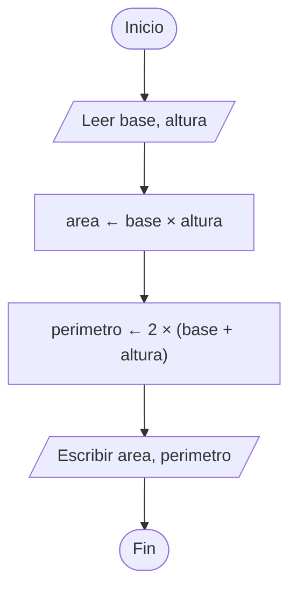
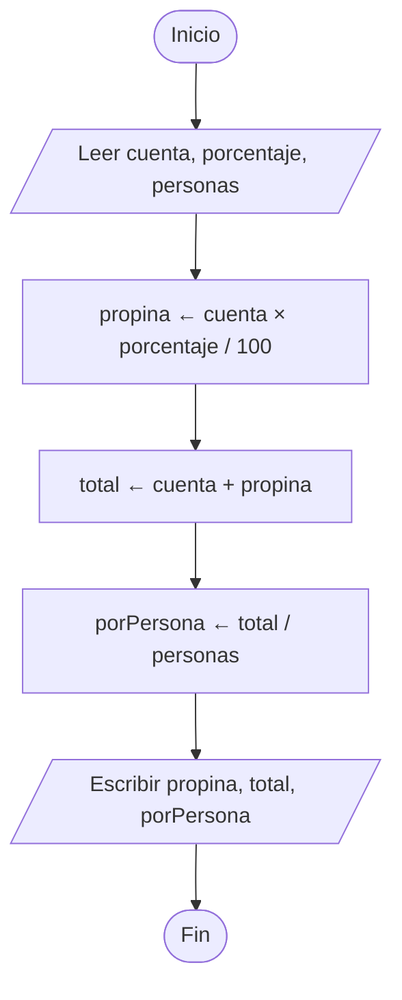
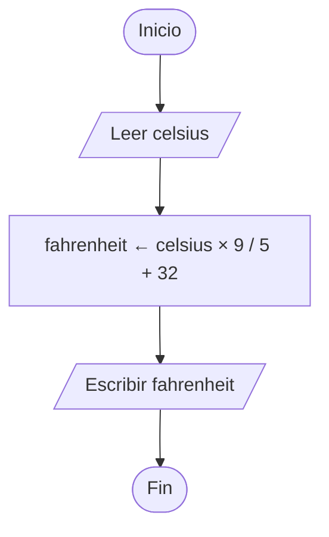

# Semana 1 · Introducción a la algoritmia y pensamiento computacional

**Evidencia pedida:** cuatro algoritmos secuenciales en PSeInt (`.psc`), cada uno con su diagrama de flujo y probado con al menos dos entradas.

## Retos

| # | Ejercicio | Archivo |
|---|---|---|
| 1 | Instrucciones sin ambigüedad (reto desconectado) | [`01-instrucciones-sin-ambiguedad.md`](01-instrucciones-sin-ambiguedad.md) |
| 2 | Mi primer algoritmo en PSeInt: entrada, proceso y salida (área y perímetro de un rectángulo) | [`02-entrada-proceso-salida.psc`](02-entrada-proceso-salida.psc) |
| 3 | Del pseudocódigo al diagrama de flujo (positivo, negativo o cero) | [`03-positivo-negativo-cero.psc`](03-positivo-negativo-cero.psc) |
| 4 | Calculadora de propinas y división de la cuenta | [`04-calculadora-propinas.psc`](04-calculadora-propinas.psc) |

## Algoritmos secuenciales (evidencia)

Los cuatro secuenciales son 02, 04, 05 y 06. El 03 tiene decisiones; el 04 solo valida antes que haya al menos 1 persona.

| Archivo | Prueba 1 | Prueba 2 |
|---|---|---|
| `02-entrada-proceso-salida.psc` | base 4, altura 3 → área 12, perímetro 14 | base 2.5, altura 10 → área 25, perímetro 25 |
| `04-calculadora-propinas.psc` | 120 000, 10 %, 4 personas → 33 000 c/u | 85 000, 0 %, 2 personas → 42 500 c/u |
| [`05-celsius-a-fahrenheit.psc`](05-celsius-a-fahrenheit.psc) | 0 °C → 32 °F | 100 °C → 212 °F |
| [`06-promedio-tres-notas.psc`](06-promedio-tres-notas.psc) | 3, 4, 5 → 4 | 2.5, 3.5, 4.2 → 3.4 |

## Diagramas de flujo

PSeInt también los genera con **«Dibujar diagrama de flujo»**.

### 02 · Área y perímetro


### 03 · Positivo, negativo o cero


### 04 · Propinas


### 05 · Celsius a Fahrenheit


### 06 · Promedio de tres notas


## Laboratorios de Moodle

**El algoritmo de preparar café (orden):** 1. hervir agua, 2. colocar café en el filtro, 3. verter agua caliente, 4. esperar el filtrado, 5. servir en una taza. Si se cambia el orden, el resultado deja de tener sentido.

**Símbolos del diagrama de flujo:**

| Símbolo | Significado |
|---|---|
| Óvalo | Inicio o fin |
| Rectángulo | Proceso (operación o asignación) |
| Rombo | Decisión (sí / no) |
| Flecha | Flujo de ejecución |

**Positivo, negativo o cero, en pseudocódigo:** el orden es `Algoritmo ClasificarNumero` → `Leer numero` → `Si numero > 0 Entonces` → `Escribir "Positivo"` → `SiNo` → `Si numero < 0 Entonces` → `Escribir "Negativo"` → `SiNo Escribir "Cero" FinSi` → `FinSi` → `FinAlgoritmo`. Está implementado en `03-positivo-negativo-cero.psc`.

**¿Paso preciso o ambiguo?**

| Instrucción | Clasificación |
|---|---|
| Agrega 5 g de sal | Preciso |
| Camina 20 pasos hacia la puerta | Preciso |
| Si el número es mayor que 0, escribe «Positivo» | Preciso |
| Repite 3 veces | Preciso |
| Agrega un poco de sal | Ambiguo |
| Camina un rato | Ambiguo |
| Si el número es grande, escribe algo | Ambiguo |
| Repite hasta que quede bien | Ambiguo |

**Pilares del pensamiento computacional:** descomposición (dividir el problema), reconocimiento de patrones (reutilizar soluciones), abstracción (quedarse con lo esencial) y diseño de algoritmos (formalizar los pasos).

## Lógica de cada algoritmo

Los `.psc` van sin comentarios; aquí está la explicación de cada uno, con su tabla y su prueba de escritorio.

### `02-entrada-proceso-salida.psc`

```text
Ejercicio 2 · Mi primer algoritmo en PSeInt: entrada, proceso y salida
Problema: calcular el área y el perímetro de un rectángulo.
Entrada: base y altura (en metros).
Proceso: area = base * altura; perimetro = 2 * (base + altura).
Salida: el área y el perímetro.
Es secuencial: no hay decisiones, las instrucciones se ejecutan una tras otra.
ENTRADA
PROCESO
SALIDA
Pruebas (al menos dos entradas):
base = 4,  altura = 3   -> Área: 12 m2   | Perímetro: 14 m
base = 2.5, altura = 10 -> Área: 25 m2   | Perímetro: 25 m
```

### `03-positivo-negativo-cero.psc`

```text
Ejercicio 3 · Del pseudocódigo al diagrama de flujo
Problema: determinar si un número es positivo, negativo o cero
(ejemplo integral del soporte temático).
Entrada: un número.
Proceso: dos decisiones encadenadas. Primero se pregunta si es mayor que 0;
         si no, se pregunta si es menor que 0; si tampoco, solo puede ser 0.
Salida: la clasificación.
El diagrama de flujo está en el README de la semana (y PSeInt lo genera
con el botón "Dibujar diagrama de flujo").
Pruebas:
numero = 7    -> Positivo
numero = -3.5 -> Negativo
numero = 0    -> Cero   (caso borde)
```

### `04-calculadora-propinas.psc`

```text
Ejercicio 4 · Calculadora de propinas y división de la cuenta
Problema: un grupo sale a comer y quiere saber cuánto paga cada persona.
Entrada: valor de la cuenta, porcentaje de propina y número de personas.
Proceso:
  propina      = cuenta * porcentaje / 100
  total        = cuenta + propina
  porPersona   = total / personas
Salida: propina, total y cuánto paga cada uno.
El cálculo es secuencial (entrada -> proceso -> salida); solo se valida antes
que haya al menos 1 persona para no dividir entre 0.
ENTRADA
Caso borde: no se puede dividir entre 0 personas ni cobrar valores negativos
PROCESO
SALIDA
Pruebas:
cuenta = 120000, porcentaje = 10, personas = 4
  -> Propina: 12000 | Total: 132000 | Cada uno: 33000
cuenta = 85000,  porcentaje = 0,  personas = 2
  -> Propina: 0     | Total: 85000  | Cada uno: 42500
cuenta = 100000, porcentaje = 10, personas = 0
  -> Error (caso borde: división entre 0)
```

### `05-celsius-a-fahrenheit.psc`

```text
Algoritmo secuencial extra (evidencia: cuatro algoritmos secuenciales)
Problema: convertir una temperatura de grados Celsius a Fahrenheit.
Entrada: grados Celsius.
Proceso: F = C * 9 / 5 + 32
Salida: grados Fahrenheit.
Pruebas:
celsius = 0   -> 32 °F
celsius = 100 -> 212 °F
celsius = -40 -> -40 °F
```

### `06-promedio-tres-notas.psc`

```text
Algoritmo secuencial extra (evidencia: cuatro algoritmos secuenciales)
Problema: calcular el promedio de tres notas de un estudiante.
Entrada: tres notas (de 0 a 5).
Proceso: suma de las tres notas dividida entre 3.
Salida: el promedio.
Pruebas:
3, 4, 5       -> Promedio: 4
2.5, 3.5, 4.2 -> Promedio: 3.4
```
