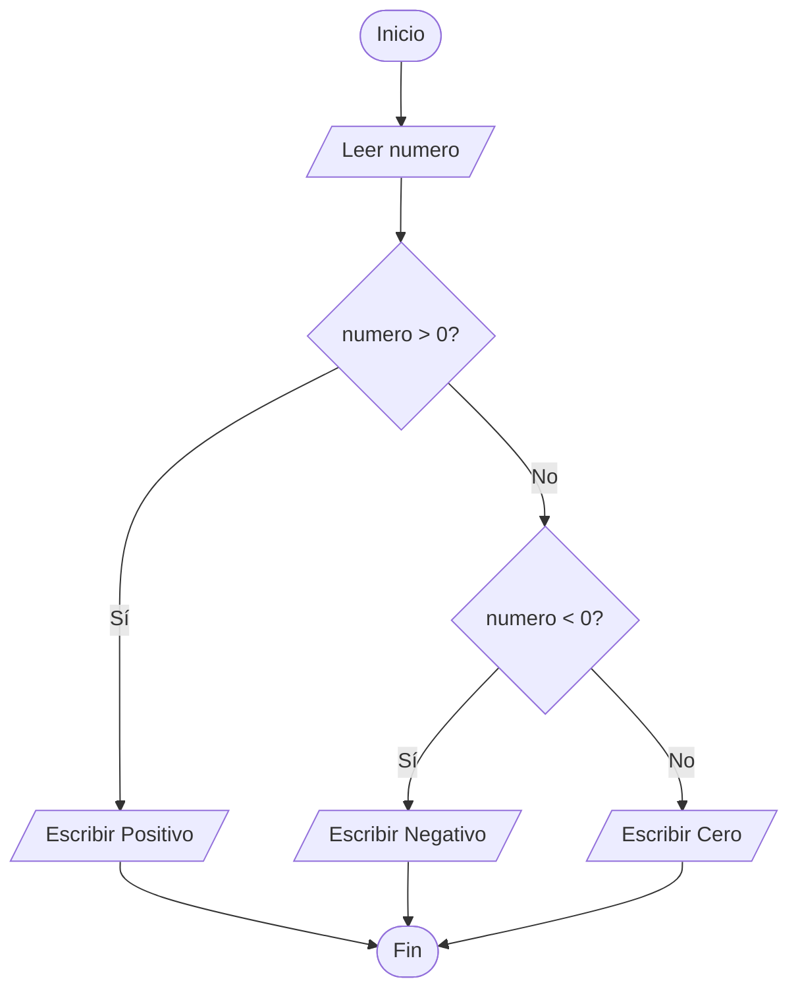
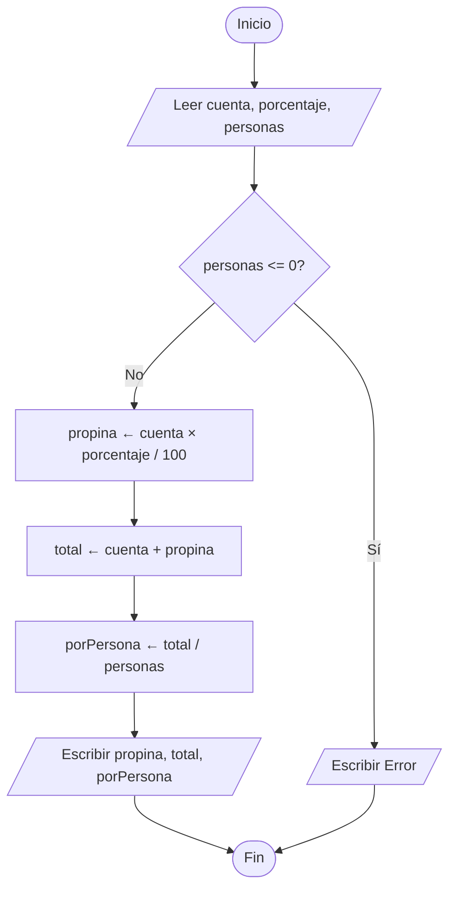
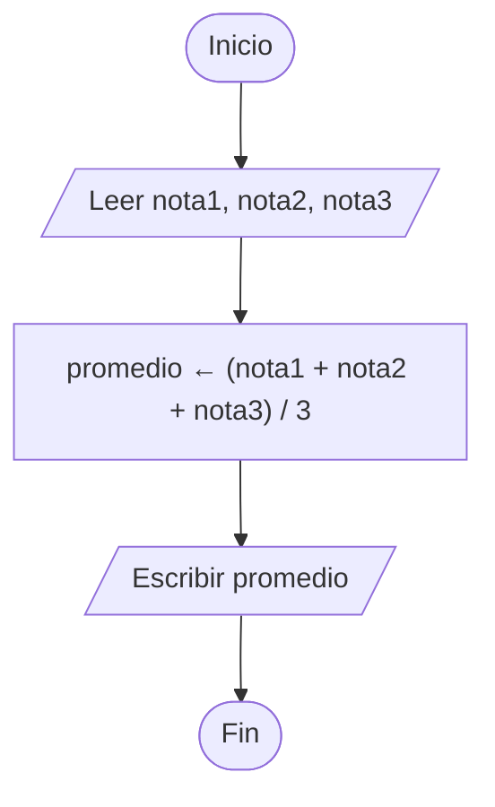

# Semana 1 - Introducción a la algoritmia

Esta semana había que hacer cuatro algoritmos secuenciales en PSeInt, con su diagrama de flujo y probados con al menos dos entradas. Hice los retos y dos algoritmos secuenciales más para completar.

## Reto 2 - Área y perímetro de un rectángulo

Pido la base y la altura, calculo `area = base * altura` y `perimetro = 2 * (base + altura)` y muestro los dos resultados. No tiene decisiones, va de arriba a abajo.

Pruebas: con base 4 y altura 3 me dio área 12 y perímetro 14. Con base 2.5 y altura 10 me dio 25 y 25.

## Reto 3 - Positivo, negativo o cero

Primero pregunto si el número es mayor que 0. Si no, pregunto si es menor que 0. Si tampoco, tiene que ser 0.

Pruebas: 7 da Positivo, -3.5 da Negativo y 0 da Cero.

## Reto 4 - Calculadora de propinas

Pido el valor de la cuenta, el porcentaje de propina y entre cuántas personas se divide. La propina es `cuenta * porcentaje / 100`, el total es cuenta más propina, y lo divido entre las personas. Le puse una validación al principio porque si ponen 0 personas PSeInt da error de división por cero.

Pruebas: 120000 con 10 % entre 4 da 33000 cada uno. 85000 sin propina entre 2 da 42500. Con 0 personas sale el mensaje de error.

## Celsius a Fahrenheit

Uso la fórmula `F = C * 9 / 5 + 32`. Probé 0 °C (da 32 °F), 100 °C (da 212 °F) y -40, que da -40 en las dos escalas.

## Promedio de tres notas

Sumo las tres notas y divido entre 3. Con 3, 4 y 5 da 4. Con 2.5, 3.5 y 4.2 da 3.4.

En PSeInt los diagramas también salen con el botón de dibujar diagrama de flujo.

## Laboratorios de Moodle

Preparar café, en orden: hervir agua, poner el café en el filtro, echar el agua caliente, esperar que filtre y servir.

Símbolos del diagrama de flujo: el óvalo es inicio o fin, el rectángulo es un proceso, el rombo es una decisión y la flecha marca por dónde sigue.

Preciso o ambiguo: "agrega 5 g de sal", "camina 20 pasos hacia la puerta", "si el número es mayor que 0 escribe Positivo" y "repite 3 veces" son precisos. "Agrega un poco de sal", "camina un rato", "si el número es grande escribe algo" y "repite hasta que quede bien" son ambiguos.

Los cuatro pilares del pensamiento computacional son descomposición, reconocimiento de patrones, abstracción y diseño de algoritmos.
