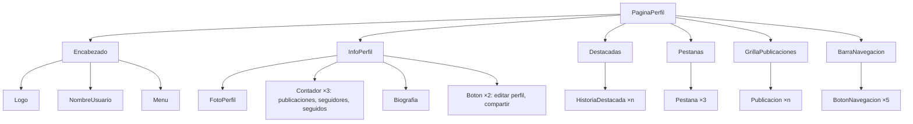

# Árbol de componentes de una página de perfil

Para esta parte tomé una página de perfil tipo Instagram y la dividí en componentes, igual que hicimos con la factura pero con la pantalla. Marqué con ×n los que se repiten.

Los que se repiten son el contador, los botones, las historias destacadas, las pestañas, las publicaciones y los botones de abajo. Cada uno se hace una vez y se reutiliza cambiándole los datos (la imagen, el texto o el número).

Me pareció parecido a los SubProcesos: cada componente recibe sus datos y muestra algo. Y la grilla de publicaciones es como un ciclo que repite la publicación por cada foto.
