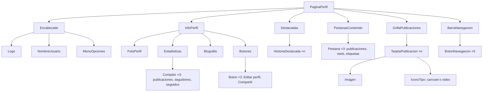

# Ejercicio 4 (segunda parte) · Árbol de componentes de una página

Es la misma descomposición top-down que la factura, pero aplicada a una interfaz. Se toma una **página de perfil de una red social** (tipo Instagram) y se divide en componentes. Los que se repiten se marcan con **(×n)**.

## Componentes que se repiten (se diseñan una vez y se reutilizan)

| Componente | Veces | Qué cambia entre una y otra |
|---|---|---|
| `Contador` | 3 | número y etiqueta |
| `Boton` | 2 o más | texto y acción |
| `HistoriaDestacada` | n | imagen y título |
| `Pestana` | 3 | ícono y si está activa |
| `TarjetaPublicacion` | n (lista) | imagen y tipo |
| `BotonNavegacion` | 5 | ícono y destino |

**Por qué sirve:** igual que un SubProceso, un componente tiene **entrada** (sus datos, por ejemplo la imagen y el título) y **salida** (lo que se ve en pantalla). La grilla de publicaciones es un **ciclo** que repite `TarjetaPublicacion` una vez por cada publicación.
